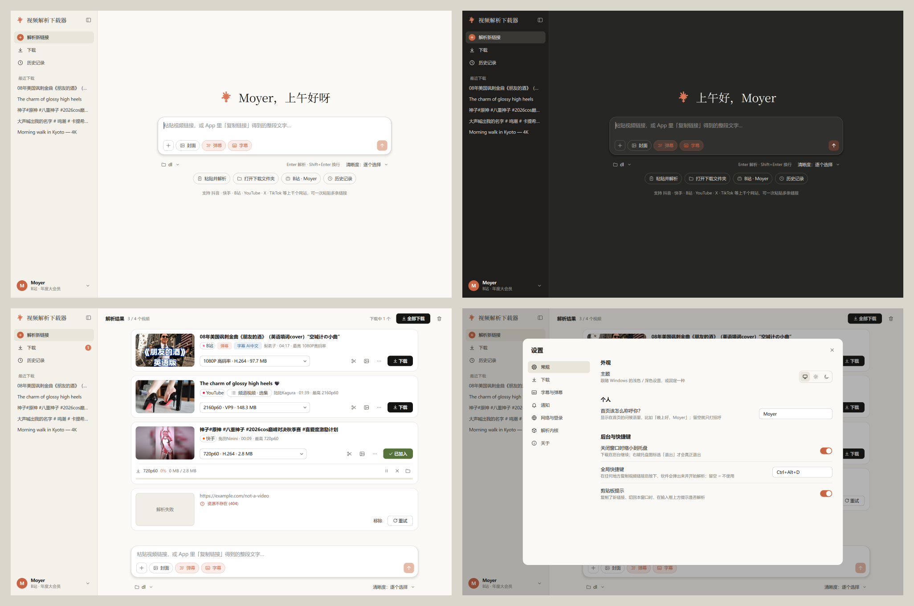
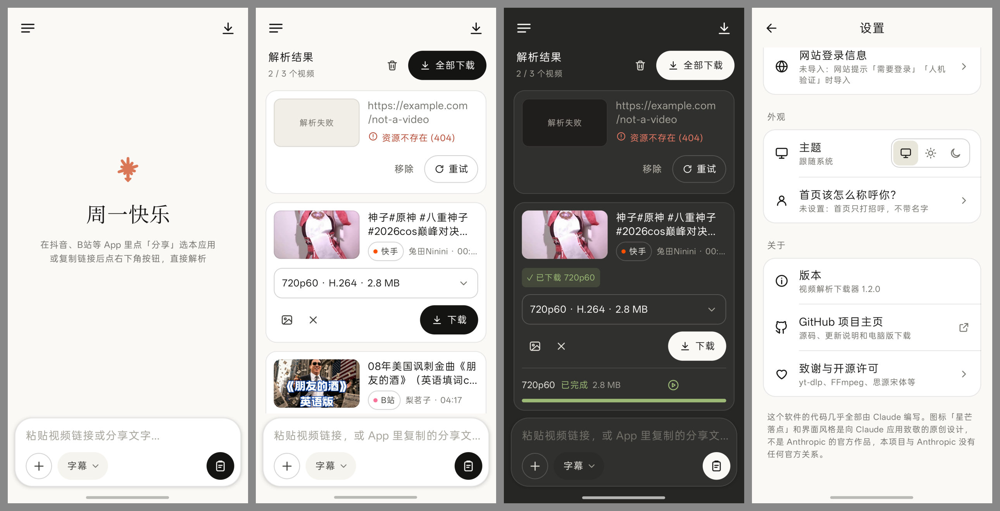

# 链接解析下载器

免费的分享链接解析 / 下载工具：粘贴分享链接（或整段分享文本）就能下载——

- **视频**：抖音、快手、B站、YouTube、X、TikTok 等上千个网站，选清晰度下载；
- **网盘**：百度网盘、夸克网盘、123云盘、Mega 的分享，勾选文件或整个文件夹下载。

2.0 起由「视频解析下载器」和「PanDL 网盘下载器」合并而成，改名为「链接解析下载器」（电脑版和安卓版都是）。

这个软件的代码几乎全部由 Claude 编写，图标和界面都向 Claude 应用致敬（原创设计，不是 Anthropic 官方作品）。





## 下载

到 [Releases 发布页](https://github.com/MoyerZhang-Claude/video-downloader/releases/latest) 下载最新版：

- **电脑版（推荐）**：`LinkDownloader-x.x.x-windows-setup.exe` 安装包，双击安装，装好后桌面和开始菜单里都有「链接解析下载器」
  （Windows 10/11，不需要管理员权限；以后的新版直接装在上面就是升级）
- **电脑版（免安装）**：`LinkDownloader-x.x.x-windows.zip`，**解压整个文件夹**后双击 `链接解析下载器.exe`

  两种版本的设置、历史记录、登录信息、头像都保存在 `%APPDATA%\VideoDownloader`，卸载、升级、换版本都不会丢。
  从 2.0 及更早的版本升级：新版第一次打开时会自动搬过来；如果新版装在了别的地方，在 设置 → 关于 →「导入旧版数据…」里选旧版所在的文件夹。
- **安卓版**：`LinkDownloader-x.x.x-android.apk`（1.x 版叫 `VideoDownloader-x.x.x-android.apk`），手机下载后点击安装，可以直接覆盖升级

程序没有代码签名，Windows 若提示“已保护你的电脑”，点“更多信息 → 仍要运行”。

## 安卓版

在抖音、B站、网盘等 App 里点「分享 → 链接解析下载器」，或复制链接后点输入框右下角的黑色按钮直接粘贴解析。下载在后台进行，
进度显示在卡片和通知栏里，视频保存到「下载/链接解析下载器」，网盘文件保存到「下载/链接解析下载器/网盘」（1.x 版的视频在「下载/视频解析下载器」，不受影响）。
界面和电脑版一样向 Claude 手机版看齐（左上角菜单里是下载、历史记录、设置、视频分区、网盘分区、最近下载），支持浅色 / 深色。

- **网盘**：和电脑版同一套网盘下载核心（编译成安卓程序随 App 安装）。扫码登录时手机扫不了自己的屏幕：
  在登录窗口点「保存二维码」（或截屏），再在网盘 App 的「扫一扫」里选相册中的这张图片。登录信息加密保存在 App 里（密钥由 Android Keystore 保管）。

- **下载加速**：B站 自动避开慢速的 PCDN 节点、测速挑最快的官方节点；其它网站多连接分段下载，某条连接太慢会自动断点续传并换线路。
  第一次下载时会提示允许「后台运行」，锁屏后也不会被系统限速。
- **B站**：扫码登录（设置页顶部，大会员 4K），合集 / 分P 选集，**弹幕版**（输入框里的选项胶囊 → 「B站弹幕版」，用手机硬件编码把弹幕画进视频，只保留弹幕版）。
- **封面**：点缩略图看大图、存到相册；也可以打开「同时保存封面」。
- **字幕**（存在「下载/链接解析下载器/字幕」，主文件夹里只放视频；B站原始弹幕在「弹幕数据」）、**下载历史**（重复下载会提醒）。
- **解析内核在线更新**：设置 → 解析内核 →「检查更新」。网站改版导致解析失败时不用等新版 App：新内核（yt-dlp 和配套的 YouTube 验证脚本）
  从 PyPI 下载、核对校验值后存在 App 里，点「立即重启」生效。默认连着 Wi-Fi 时每天自动检查并下载一次；出问题可以「恢复为内置版本」。
- **新版本提醒**：启动时检查 GitHub 上有没有新的安卓版，有就弹窗（可以跳过某个版本）；设置 → 关于 →「版本」也能手动检查。
- **网站登录信息**：TikTok、Vimeo 等需要登录的网站，或 YouTube 提示「人机验证」时，用电脑浏览器扩展 **Get cookies.txt LOCALLY**
  导出 cookies，在「设置 → 网站登录信息」导入（也可以在文件管理器里把文件「分享」给本应用）。登录信息只保存在手机上这个 App 里。
- **YouTube**：手机上没有 Node.js，借用系统 WebView 的 V8 引擎解 YouTube 的 JS 验证，清晰度和电脑版一致。
- HLS 格式会自动转成标准 MP4；选中的清晰度下载失败时，会自动换同一视频的其它格式再试。

## 启动（本地开发）

| 方式 | 说明 |
| --- | --- |
| 双击 `启动.bat` | 源码版，用项目里的 `.venv` 运行，可在设置里在线更新解析内核；第一次运行会先编译网盘引擎（需要 [Go](https://go.dev/dl/)） |
| `dist\链接解析下载器\链接解析下载器.exe` | 打包版（`打包.bat` 生成），整个 `链接解析下载器` 文件夹可以拷到别的电脑直接用 |
| `dist\installer\LinkDownloader-x.x.x-windows-setup.exe` | 安装包（`打包.bat` 最后一步用 [Inno Setup 6](https://jrsoftware.org/isinfo.php) 生成，配置在 `installer.iss`） |

## 使用

界面向 Claude 应用看齐：左边侧边栏（解析新链接 / 下载 / 历史记录 / 最近下载），中间是大输入框，支持浅色 / 深色（默认跟随系统，
设置 → 常规 → 主题）。在 设置 → 常规 填上称呼，首页会显示「晚上好，xxx」。

1. 复制视频或网盘的分享链接（App 里“复制链接”得到的整段文字也行），粘贴到输入框，按 **Enter**（或点右下角橙色箭头）解析，Shift+Enter 换行。
   视频和网盘链接可以混在一起粘贴，软件会自动分开处理（网盘见下面的「网盘分享」）。
   - 复制链接后切回本窗口，输入框上方会提示「剪贴板里有新链接」，点「解析」即可（打开软件时不会自动解析）。
   - 一次可以粘贴多条，自动提取其中所有链接；输入框左下角的 **+** 还可以从文本文件导入链接。
   - 输入框里的 **封面 / 弹幕 / 字幕** 开关：打开后下载视频时顺便保存封面、弹幕、字幕（变成橙色表示已打开）。
2. 解析结果是一张张卡片（最新的在最上面），在下拉框里选择清晰度（显示分辨率、编码和预估大小），点 **下载**，进度直接显示在卡片里。
   - **点击封面**可以看大图、复制或保存；卡片上的图片按钮直接把封面保存到下载目录，剪刀按钮只下载一段，「⋯」里有更多操作。
   - 输入框右下方的「清晰度」可以一键把所有结果设为 最高 / 1080p / 720p / 仅音频 MP3 等，再点顶部的 **全部下载**。
   - 也可以选“仅音频”：保留原始音轨（M4A 等）或转为 MP3。
3. 侧边栏「下载」页列出全部任务，支持 暂停 / 继续 / 取消 / 重试；暂停或退出后，再次下载同一视频同一清晰度会自动断点续传。
4. 默认保存到 `D:\Claude\vedio download\Download`，输入框左下方的文件夹按钮可以打开或更改，设置会自动保存。

## 网盘分享

支持 **百度网盘、夸克网盘、123云盘、Mega**。网盘部分来自同一作者的 [PanDL 网盘下载器](https://github.com/MoyerZhang-Claude/cloud-drive-link-parsing)，
它的下载核心（Go 编写，源码在 `pan\`）编译成 `pan-engine.exe` 在后台运行，界面和视频部分是同一套。

1. 粘贴分享链接，提取码写在链接里（`?pwd=xxxx`）或文字里（「提取码：xxxx」）都能自动识别；没有提取码时卡片里会让你输入。
2. 卡片里列出分享的文件：勾选文件或整个文件夹（点开文件夹才会读取里面的内容，可以只勾其中几个），点 **下载**。
   只有一个文件的分享直接点下载就行。文件按分享里的目录结构保存到下载目录（按平台分文件夹时在 `Download\百度网盘\` 这样的子文件夹里）。
3. 进度显示在卡片下方和「下载」页（一次下载的一批文件是一张卡片，点 ⌄ 看每个文件，失败的可以单独重试）。
   没下完就退出软件的，下次打开自动继续。
   网盘下载下来的文件常常会被移走、解压，所以软件不记下载后的网盘文件，而是**记分享链接**：分享一打开就记一条解析记录，
   自动放进侧边栏「网盘分区」里对应的网盘（可以重命名、移到自建的网盘分区），以后点一下就重新解析这个分享。
4. **登录**：百度网盘、夸克网盘、123云盘需要登录才能下载（Mega 不用）。卡片里点「扫码登录」，或 设置 → 网络与登录 → 网盘账号，
   用对应的 App 扫码。登录信息用 Windows 自带的加密（DPAPI）保存在 `%APPDATA%\VideoDownloader\pan`，只有当前 Windows 用户能解开。
   用过 PanDL 的话，第一次打开会自动把它保存的网盘账号复制过来，不用重新扫码。
5. 各网盘的特点：
   - **百度网盘**：登录后直接下载分享，不用转存；会员多连接下载能跑满带宽，非会员只用 1 条连接（避免被限速）。偶尔要输入图片验证码，会弹窗。
   - **夸克网盘**：夸克只允许下载自己网盘里的文件，所以会先**临时转存**到你网盘的「PanDL临时转存（可删除）」文件夹，下完自动删除。
   - **123云盘**：直接下载别人的分享会用掉分享者的流量包；对方流量不够时自动临时转存到你的网盘再下，下完清理。
   - **Mega**：不用登录，边下边解密。
   - 下完自动校验（Mega MAC、123 / 百度 MD5、夸克 CRC64），通过时显示「✓ 校验通过」。
6. 设置 → 下载 →「网盘下载」里可以改同时下载的文件数、每个文件的连接数、限速和自动重试次数。

## 已验证的平台

| 平台 | 说明 |
| --- | --- |
| 抖音 | 自研解析，免登录、无水印；可选 540p / 720p / 1080p / 原画（作者上传的原文件，可能是 4K H.265） |
| 快手 | 自研解析，免登录；H.264 / H.265 两种编码 |
| B站 | 免登录最高 1080P；点首页的「B站扫码登录」（或左下角头像菜单）扫码后，大会员可下 1080P 高码率 / 1080P 60帧 / 4K / HDR / 杜比视界，并可单独下载 FLAC 无损、杜比音轨 |
| YouTube | 144p ~ 4K（音视频自动合并为 MP4）；需要电脑上装有 Node.js 或 Deno（安卓版自带，不用装） |
| X (Twitter) | 公开推文的视频 |
| TikTok | 公开视频免登录；被标记为“敏感内容”的视频需要登录 cookies |

其它网站由 [yt-dlp](https://github.com/yt-dlp/yt-dlp) 提供支持（上千个站点），可以直接试。

## 合集 / 分P / 播放列表

- **B站合集、多P**：分享其中任意一集的链接就行。解析结果上会出现「合集 133/134 · 选集…」按钮，
  点开可以搜索、全选 / 反选 / 「当前之后全部」，勾选后加入解析；默认「解析完自动下载」，按输入框下方「清晰度」的设置下载。
- **YouTube 播放列表**：YouTube 的「分享」按钮会去掉列表信息，请**复制浏览器地址栏里的链接**（带 `&list=`）。
  普通分享链接（`youtu.be/xxx`）会显示「频道视频 · 选集…」，可以从该频道的全部视频（最多 1000 个）里搜索勾选。
- 直接粘贴播放列表 / 收藏夹 / 频道等链接时，也会先弹出选集窗口，不会一下子全部解析。

## 只下载片段

结果卡片上的 **剪刀** 按钮（或右键「下载片段…」）：输入起止时间（1:23、83、1:02:03、1分23秒 都行），只下载这一段，不用下完整视频。
文件名会带上片段时间，如 `标题 [1080P高清] [片段 1m00s-1m30s].mp4`；勾选「精确剪切」时切点精确到帧（稍慢）。
B站片段的弹幕会自动对齐到片段时间（弹幕版照常生成）；片段暂不下载字幕。YouTube 片段受其限速影响会慢一些。

## 弹幕与字幕

- **B站弹幕**：打开输入框里的「弹幕」开关，下载时会把弹幕转成与视频同名的 `.danmaku.ass`。
  用 PotPlayer / MPC-HC / VLC / mpv 打开视频会自动加载，离线也能看弹幕（滚动、顶部、底部、彩色弹幕都支持）。
- **弹幕版视频**（默认开启）：外挂弹幕只能跟着视频帧刷新，30 帧视频里会一跳一跳、有残影；软件会另外生成
  `标题 [清晰度] [弹幕版].mp4`，把弹幕按 60 帧（可选 120 帧）画进视频，任何播放器里都和网页版一样顺滑。
  默认只保留弹幕版（原视频和外挂弹幕自动删除，字幕改名配给弹幕版）；想同时保留原视频可在 设置 → 字幕与弹幕 打开。
- **字幕**：打开输入框里的「字幕」开关，会下载 B站 CC 字幕（含 AI 字幕，需要登录）和 YouTube 等网站的字幕，保存为同名 `.srt`。
  默认「中文 + 原语言」：外语视频同时得到中文和原文字幕，没有人工中文字幕时用 YouTube 的自动翻译中文。可在 设置 → 字幕与弹幕 里改。
- 解析结果里会用标签标出「弹幕」「字幕 简中/英文」。字幕/弹幕下载失败不会影响视频本身。

## 关闭后任务自动恢复

没下完就关掉软件时，未完成的任务会保存下来；下次打开自动恢复到下载列表（已暂停），点「全部继续」从断点接着下。

## 历史记录 · 分区 · 最近下载 · 搜索

- **历史记录**：记的是**解析记录**——解析过的视频和网盘分享都会记一条（同一个只留一条），点一下就重新解析。
  顶部可以筛选 全部 / 视频 / 网盘；「已下载的视频」里是下载好的视频（可以直接打开）。
- **视频分区**：B站、X、YouTube、抖音、快手（+ 自建），放**下载好的视频**，按平台自动放进去。
- **网盘分区**：百度网盘、夸克网盘、123云盘、Mega（+ 自建），放**网盘分享的解析记录**，点一下重新解析。
  分区图标是各平台 logo 的单色轮廓，跟着主题变色。点「+」可以新建分区、从图标库挑图标；右键（手机长按）记录 →「移至分区」。
- **最近下载**（侧边栏下方）：只放下载好的视频。
- **重命名**：右键（手机长按）记录 →「重命名」，只改软件里显示的名字，不动文件；留空恢复原标题。
- **搜索**：电脑版侧边栏「搜索」（或 Ctrl+K），手机版侧边栏右上角的放大镜，搜解析记录、下载好的视频和分区。

## 头像

- **电脑版**：左下角头像菜单 →「设置头像…」，或 设置 → 常规 → 个人 → 头像。选一张图片（JPG / PNG / WebP / BMP / GIF / TIFF），
  拖动图片选位置，滚轮或滑块缩放，可以旋转 90°，右边实时预览；保存后显示为圆形头像。之后可以「调整…」重新框选（保留了原图和上次的位置）或「移除」。
  头像在程序目录的 `avatar\` 文件夹（圆形 `avatar.png` + 原图），打包时会自动保留。
- **手机版**：设置 → 个人 → 头像，从系统照片选择器选图（不需要存储权限），双指缩放、拖动框选，双击复位。头像只存在 App 私有目录里。

## 下载历史 · 完成提醒 · 自动分文件夹

- **下载记录**：历史记录页的「已下载的视频」可搜索、打开文件、重新解析（鼠标移到某一行上会出现操作按钮），侧边栏下方也列出最近下载的视频。解析到下载过的视频时显示绿色「✓ 已下载」标记；
  再点「下载」会询问「打开已有文件 / 重新下载」，「全部下载」会自动跳过已下载过的。记录保存在数据目录（`%APPDATA%\VideoDownloader`）的 `history.db`。
- **完成提醒**：窗口不在前台时弹系统通知；全部完成时播放提示音；也可以设置全部完成后自动打开下载文件夹。
- **自动分文件夹**：设置里可选按平台（`Download\B站\`）或按平台 + 作者（`Download\B站\UP主名\`）。
- **封面写进视频**：默认开启，资源管理器缩略图和播放器里直接显示封面。

## B站大会员画质（扫码登录）

1. 点首页的 **B站扫码登录**（或左下角头像菜单、设置 → 网络与登录），选 **长效登录（电视端扫码，约 180 天，推荐）**，用哔哩哔哩手机 App「扫一扫」扫码并确认。
   手机上会显示「登录云视听小电视」，这是正常的：软件只用它下发的网页登录信息，解析仍走网页接口，
   清晰度、弹幕、字幕和网页登录完全一样。也可以选「网页扫码登录」（有效期约 7 天）。
2. 左下角会显示你的 B站昵称和「年度大会员」，列表里已有的 B站视频会自动重新解析，下拉框里就有 4K 超高清、1080P 高码率等选项。
3. 没登录时，被锁住的清晰度会在下拉框最后一行以 🔒 标出。
4. 登录信息保存在 `%APPDATA%\VideoDownloader`（源码版和打包版共用一份，也不会随程序文件夹被拷走）。快过期时会提醒，重新扫码即可。
5. 登录过期时左下角会显示「B站登录已失效」，点一下重新扫码即可。

## 后台运行 · 全局快捷键 · 内核更新

- **缩小到托盘**：点窗口的关闭按钮只是缩小到右下角托盘，下载继续；右键托盘图标选「退出」才真正退出（设置里可改回直接退出）。
- **全局快捷键**（默认 `Ctrl+Alt+D`）：在任何地方复制视频链接后按一下，软件弹出来并开始解析。可在 设置 → 常规 里改。
- **一键更新解析内核**：设置 → 解析内核 →「检查并更新」。打包版把新内核下载到数据目录的 `core_update` 文件夹，重启生效，不用重新打包（装了自带更新内核的新版后，旧的下载自动作废）；
  启动时也会自动检查新版本并提示。更新后出问题可以点「恢复为打包时内置的版本」。
  下载的是 yt-dlp 和它要求的 yt-dlp-ejs（YouTube 验证脚本，两者版本必须配套），都会核对 PyPI 给出的 sha256，不一致就不安装。
- **软件新版本提醒**：启动时检查 GitHub 上有没有新的电脑版，有就弹窗（去下载 / 以后再说 / 跳过这个版本）；
  设置 → 关于 →「检查更新」可以手动检查。电脑版和安卓版各自看自己的安装包版本号。

## 解析自检（开发用）

双击 `测试解析.bat`（或 `.venv\Scripts\python.exe tools\check_links.py 链接文件.txt`）：把 `test.txt` 里的链接逐个解析，
再真的去请求每个视频默认清晰度的开头 64 KB（不保存），能发现「能解析但下不了」这种网站改版时最常见的坏法。
链接文件里可以夹杂分享文案和备注，网盘链接会跳过。全部通过退出码为 0。打包发布前跑一遍。

## 设置说明

- **同时下载任务数**：默认 3。
- **分片下载线程**：HLS/DASH 分片格式每个任务的并发连接数，默认 4。
- **文件名格式**：默认 `标题 [清晰度].mp4`，同一视频下不同清晰度不会互相覆盖。
- **编码偏好**：同一清晰度有多种编码时（YouTube、B站），“兼容优先”选 H.264，“体积优先”选 AV1/VP9/H.265。
- **代理**：留空跟随系统代理；也可以填 `http://127.0.0.1:7890` 这类地址。
- **Cookies**：B站用扫码登录就行，不用在这里设置。其它需要登录才能看的内容才需要。
  - “从浏览器读取”：推荐 **Firefox**（先在 Firefox 里登录对应网站）。新版 Chrome / Edge 对 cookies 做了加密，通常读取失败。
  - “cookies.txt 文件”：在浏览器装扩展 **Get cookies.txt LOCALLY**，登录网站后导出 cookies.txt，然后在设置里选择该文件。

## 常见问题

- **某个网站突然解析失败**：网站经常改版，先在 设置 → 解析内核 点 **检查并更新**，重启程序。
- **YouTube 提示人机验证**：这是 YouTube 对代理 / VPN 节点的风控，换个节点，或把 YouTube 的 cookies.txt 放进 `cookies` 文件夹（设置 → 网络与登录 里点「打开文件夹」）。
- **B站下载很慢**：B站给的默认地址常是 PCDN 节点，软件会自动测速换成官方节点；日志里能看到「已选用较快的下载节点」。
- **出错详情**：鼠标悬停在红色错误上可以看到原始信息；左下角头像菜单 →「查看日志」有完整记录，数据目录的 `logs\app.log` 里也有。

## 目录结构

```
app\            程序源码（gui.py 界面，core.py 视频解析/下载核心，extractors.py 抖音/快手解析，pan.py / pan_ui.py 网盘部分）
pan\            网盘下载核心（Go，原 PanDL）：internal\ 各网盘适配与下载引擎，cmd\pan-engine 给界面用的后台进程，docs\ 设计与交接记录
编译网盘引擎.bat  编译 pan\bin\pan-engine.exe（需要 Go）
测试解析.bat    解析自检（tools\check_links.py）
ffmpeg\         合并音视频、转 MP3 用的 ffmpeg（来自 github.com/yt-dlp/FFmpeg-Builds）
main.py         程序入口
build.spec      PyInstaller 打包配置
installer.iss   安装包配置（Inno Setup 6）；installer\ChineseSimplified.isl 是安装界面的简体中文（Inno Setup 社区翻译）
```

用户数据都在 `%APPDATA%\VideoDownloader`（设置 → 关于 →「数据文件夹」可以直接打开）：

```
config.json     设置
history.db      解析记录和下载历史
tasks.json      没下完的任务（下次打开时恢复）
cookies\        浏览器导出的 cookies.txt（如 TikTok），放进来自动生效（勿外传）
avatar\         头像（圆形 avatar.png + 原图，用于重新调整）
logs\           日志
core_update\    打包版在线更新的解析内核
pan\            网盘账号（加密）、网盘下载任务和设置
bilibili.txt    B站登录信息
```

默认下载目录是「下载\链接解析下载器」，可以在输入框下方或设置里改。

## 图标与致谢

本项目的代码几乎都由 [Claude](https://claude.ai) 编写。软件图标「星芒落点」向 Claude 致敬：陶土橙星芒的最下面一道伸长成下载箭头，
是原创图形，并非 Anthropic / Claude 的官方标志，本项目与 Anthropic 没有官方关系。图标由 `图标设计/星芒落点/draw_icon.py` 生成。

视频解析能力来自 [yt-dlp](https://github.com/yt-dlp/yt-dlp)；网盘部分来自 [PanDL 网盘下载器](https://github.com/MoyerZhang-Claude/cloud-drive-link-parsing)。
各平台 logo 是各自的商标，只用来标识对应的分区。
